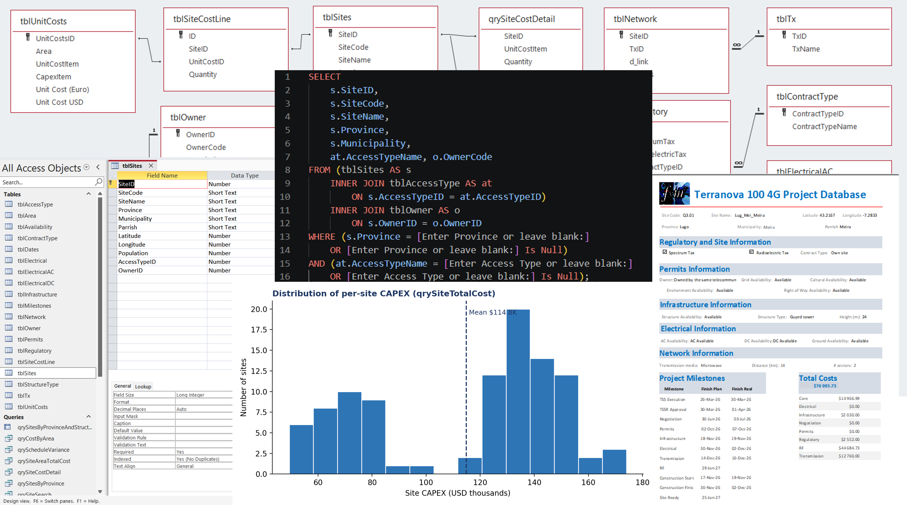
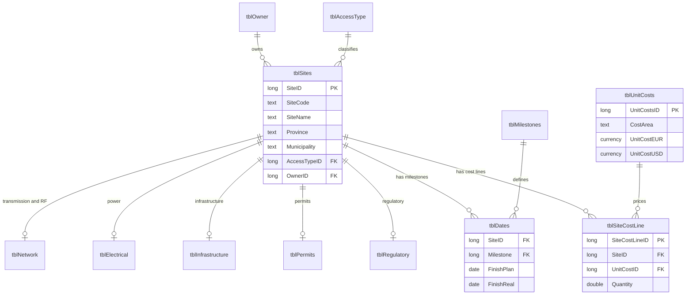
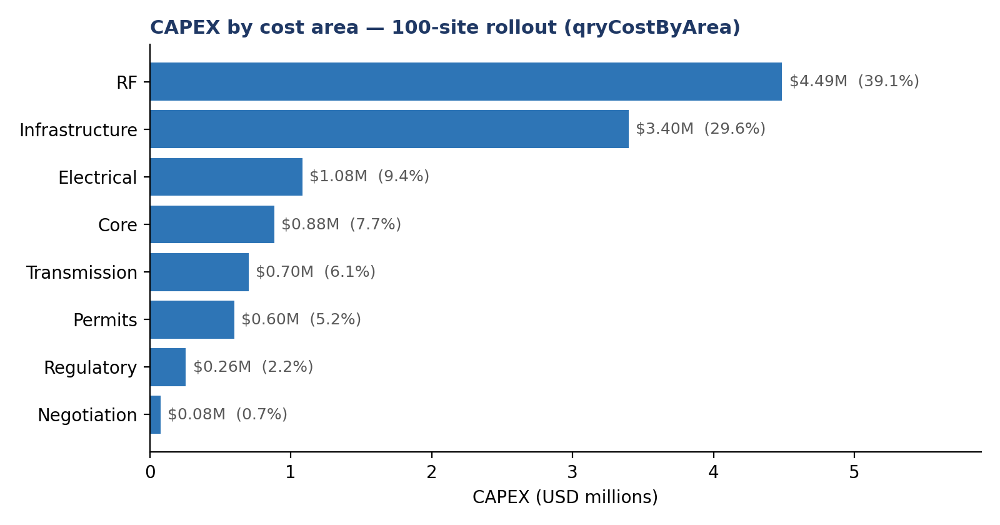
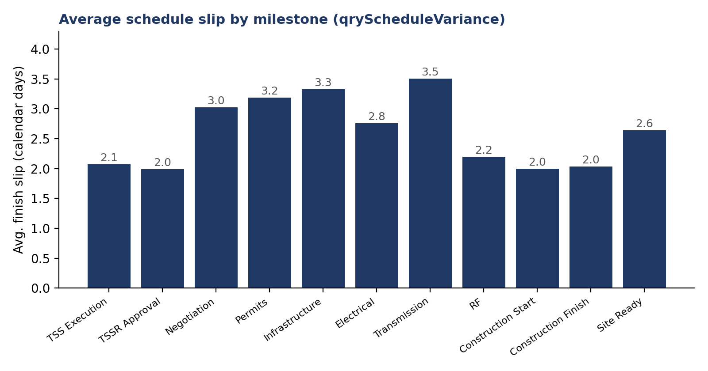
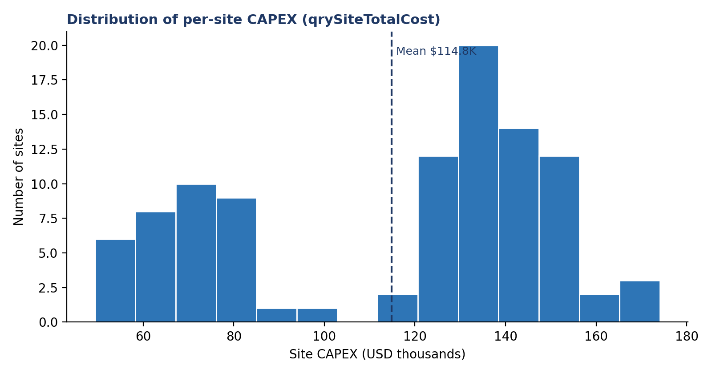
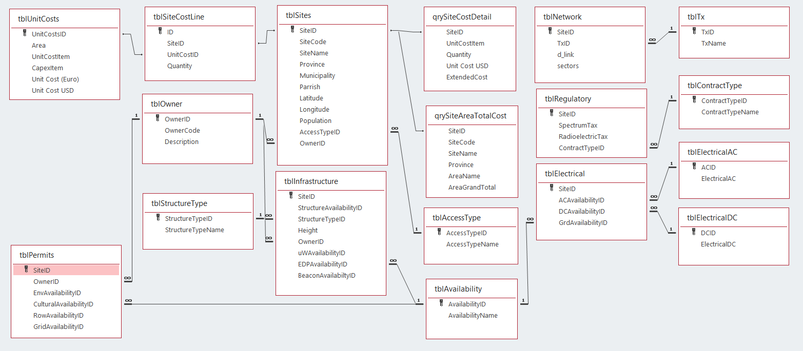
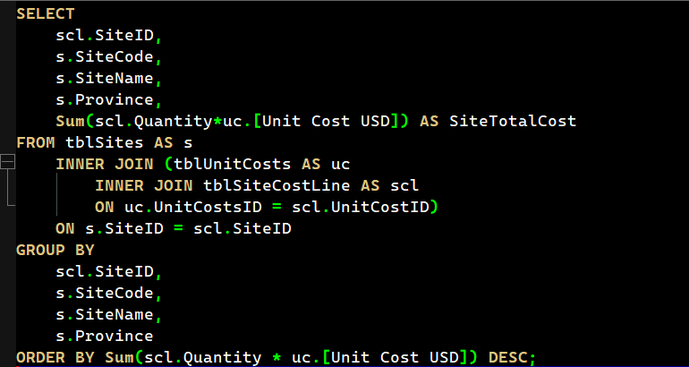
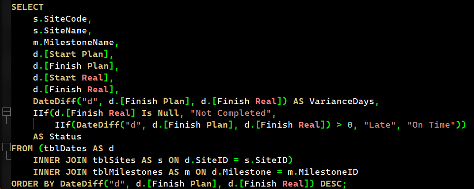
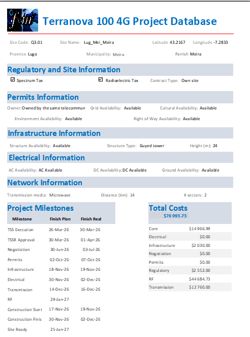
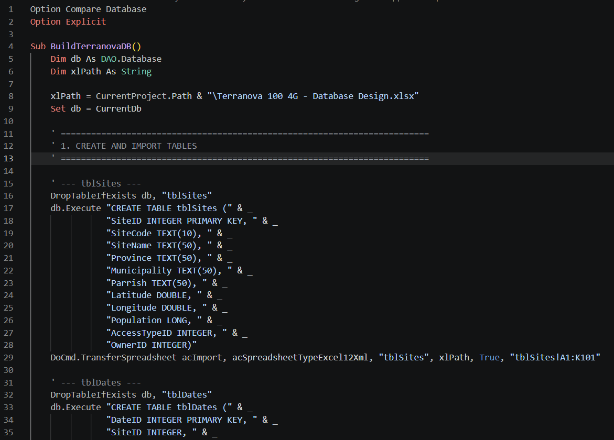

# Terranova: Relational Database & Executive Reporting System


> [!NOTE]
> **Portfolio project.** Built from 30+ years of hands-on experience managing large-scale mobile network rollouts. The company name, geography and all figures are **fictional (synthetic data)**. The goal is to demonstrate how I design relational databases and turn complex project data into SQL queries and executive-ready reports.

**From scattered spreadsheets to one auditable source of truth: 100 sites, 4,600 cost lines and 1,100 schedule milestones, answered in seconds.**



---

## Table of Contents

1. [Project Overview](#1-project-overview)
2. [Headline Results](#2-headline-results)
3. [Data Architecture](#3-data-architecture)
4. [Role & Responsibilities](#4-role--responsibilities)
5. [The Challenge](#5-the-challenge)
6. [Approach & Implementation](#6-approach--implementation)
7. [Data Quality & Validation](#7-data-quality--validation)
8. [Results & Business Value](#8-results--business-value)
9. [Visuals](#9-visuals)
10. [Skills Demonstrated](#10-skills-demonstrated)
11. [Lessons Learned](#11-lessons-learned)
12. [About the Author](#12-about-the-author)

---

## 1. Project Overview

**Terranova** is a normalized relational database and reporting system built to plan, cost and track a **100-site rural 4G network rollout** across four provinces of northern Spain (A Coruña, Asturias, Lugo, Pontevedra), serving an estimated **99,320 inhabitants**.

It replaces scattered spreadsheets with a single source of truth that connects site data, regulatory and permitting status, infrastructure, power, transmission/RF design, a unit-cost catalogue and an 11-milestone schedule for every site. On top of the model sit parameterized SQL queries, a multi-subreport **Site Profile** report and a VBA automation layer that produces recurring management reports.

### Business questions the system answers

| Management question | Delivered by |
|---|---|
| Where is the money going? | `qrySiteTotalCost`, `qryCostByArea` |
| What is late, and by how much? | `qryScheduleVariance`, `qryScheduleSlipByMilestone` |
| Which sites need attention? | Parameterized site search, Site Profile report |
| Can I get a pack per site or per province? | One-click PDF export (VBA) |

### Project at a glance

| Metric | Value |
|---|---|
| Sites modelled | **100** (4 provinces, 98 municipalities) |
| Population served | **99,320** inhabitants |
| Database tables | **19** (9 core + 10 lookup), **16** defined relationships |
| Cost lines (site × catalogue item) | **4,600** (46 per site) |
| Unit-cost catalogue | **45 priced items** across **8 cost areas**, in EUR and USD, plus 1 manual-adjustment row |
| Schedule records | **1,100** (11 milestones × 100 sites, planned vs. actual) |
| Total modelled CAPEX | **€9.90 M / US$11.48 M** (catalogue-priced) |
| Saved analytical queries | **7**, including a parameterized search |
| Report | **Site Profile** with **7 subreports** |

<!-- TODO: confirm "45 items + 1 manual-adjustment row = 46 catalogue rows" matches your tblUnitCosts. State the exact EUR/USD rate (implied by the figures: about 1.16). -->

---

## 2. Headline Results

All figures are computed directly from the database.

| Finding | Evidence | Recommended action |
|---|---|---|
| **RF and Infrastructure drive 69% of CAPEX** | RF US$4.49 M (39.1%) + Infrastructure US$3.40 M (29.6%) of US$11.48 M | Concentrate vendor negotiation and design standardization on these two areas |
| **Average site CAPEX US$114.8 K**, ranging US$49.4 K to US$174.1 K | `qrySiteTotalCost` | Review the highest-cost sites first; a 3.5× spread points to design or scope variance |
| **Cost per inhabitant covered ≈ US$116** | US$11.48 M ÷ 99,320 inhabitants | Use as a benchmark KPI to prioritize and compare sites |
| **Standardized structures** | 83 of 100 sites use monopoles; mean height 21.1 m | Supports bulk procurement and repeatable designs |
| **Access type is associated with cost** | Pedestrian-access sites average US$102 K vs. US$120 K for aerial access | Treat access logistics as a planning-stage cost driver |
| **Land-tenure mix** | 35 company-owned, 24 public schools, 21 private, 20 local-government; 44 agreements, 35 own sites, 21 leases | Anticipate permitting and negotiation effort by tenure type |
| **Schedule: consistently slightly late** | Of 736 milestones with a recorded finish, **612 (83%)** closed after plan by an average of **2.6 days**; none by more than 5 days | Small slips compound across 11 sequential milestones; manage them early |
| **Transmission, Infrastructure and Permits slip most** | Average slip of 3.5, 3.3 and 3.2 days | Add buffers and earlier submission to protect these milestones |
| **Progress snapshot** | 60 sites with construction finished, 45 sites ready, from 1,100 tracked milestones | Baseline for the next reporting cycle |

<!-- TODO: confirm whether the per-milestone slip averages (3.5 / 3.3 / 3.2) are "when late" or over all completed milestones; qryScheduleSlipByMilestone in section 6.3 returns the "when late" figure. -->

---

## 3. Data Architecture

The model is normalized to **third normal form** with surrogate keys and lookup tables that enforce controlled vocabularies (owner type, access type, structure type, availability status, transmission medium and others).



<!-- TODO: verify cardinalities (1:1 vs 1:N) and key names against your Access relationship diagram. -->

*Simplified view. Field names that contain spaces in Access (for example `[Unit Cost USD]`) are shown without spaces, and 7 further lookup tables are omitted. The full relationship diagram is in section 9.*

### Core tables

| Table | Purpose | Grain |
|---|---|---|
| `tblSites` | Site master data: location, owner, access type | 1 row per site |
| `tblDates` | Planned vs. actual finish dates for 11 milestones | 1 row per site × milestone |
| `tblRegulatory` | Regulatory status and fees | 1 row per site |
| `tblPermits` | Permitting status | 1 row per site |
| `tblInfrastructure` | Structure type, height, shelter, enclosure | 1 row per site |
| `tblElectrical` | Power supply design | 1 row per site |
| `tblNetwork` | Transmission and RF design | 1 row per site |
| `tblUnitCosts` | Unit-cost catalogue in EUR and USD | 1 row per catalogue item |
| `tblSiteCostLine` | **Fact table:** quantity of each catalogue item per site | 1 row per site × catalogue item |

### Key design decisions

| Decision | Rationale |
|---|---|
| **Costs modelled as facts, not columns** | The first design held about 27 cost values as separate columns and left the price catalogue unlinked. `tblSiteCostLine` now stores Quantity per site and item, so every cost is `Quantity × Unit Cost`, traceable and repriceable in one place |
| **Surrogate keys** | Stable joins that do not depend on business codes that may change |
| **Lookup tables with foreign keys** | Controlled vocabularies; invalid values are rejected at entry, not found at reporting time |
| **Zero-quantity lines kept** | Every site carries the full set of cost lines, so comparisons across sites are like-for-like |
| **Totals never stored** | Totals are always calculated by queries, so they cannot drift from the underlying data |

---

## 4. Role & Responsibilities

**Role:** Database Designer & Project Reporting Lead (sole author of this portfolio project)

- **Design:** Entity-relationship model, normalization to 3NF, `tbl` / `qry` / `rpt` naming conventions, lookup tables, primary and foreign keys, and the cost-model redesign.
- **Planning:** Defined the reporting requirements and KPIs (CAPEX by area, province and site; schedule variance by milestone; permit and infrastructure readiness) and mapped each one to a query, report or dashboard view before building.
- **Execution:** Built tables, relationships, SQL queries, report layouts and VBA automation; loaded and reconciled the data; validated totals.
- **Regular reporting:** Produced recurring status reports and refreshed dashboards, translating findings into conclusions and recommended actions.

---

## 5. The Challenge

A rural rollout of 100 sites is a data-integration problem as much as an engineering one. Each site carries information owned by different teams: land and negotiation, permits, civil works, power, transmission, RF and regulatory fees.

1. **Fragmented data:** Cost, schedule and technical attributes lived in separate sheets, making site-level and portfolio-level answers slow and error-prone.
2. **Unstructured cost data:** About 27 cost values sat in separate columns across five domain tables, with the catalogue unlinked. Totals could not be traced to a price and a quantity.
3. **No consistent view of schedule performance:** Planned and actual dates for 11 milestones per site had to be compared systematically to expose delays early.
4. **Repeatable reporting:** Stakeholders needed the same trusted numbers every cycle without rebuilding reports by hand.

**Goal:** a normalized, auditable database with query-driven reports that answers *where is the money going, what is late, and which sites need attention* in seconds.

---

## 6. Approach & Implementation

### 6.1 Methodology

- **Requirements-first design** aligned with **PMBOK** knowledge areas (cost, schedule, scope), so every table and query traces to a project-management question.
- **Relational modelling** with an ERD, 3NF, surrogate keys and lookup tables.
- **Structured improvement cycle** (define, measure, analyze, improve, control) applied to the reporting process itself.

### 6.2 Build steps

1. **Data modelling:** 9 core tables and 10 lookup tables, with foreign keys enforcing consistency.
2. **Cost-model redesign:** Replaced about 27 scattered cost columns with the single `tblSiteCostLine` fact table, linked to `tblSites` and `tblUnitCosts`. Totals were reconciled against the original model.
3. **Query layer (SQL):** Reusable queries for cost roll-ups, schedule variance, geographic and technical distributions, and a parameterized site search.
4. **Report layer:** The **Site Profile** report: one page per site, composed of 7 subreports (dates, regulatory, permits, infrastructure, electrical, network, cost lines).
5. **Automation (VBA):** Routines that generate reports on demand and export them to PDF per site or per province.
6. **Validation & reporting:** Cross-checked totals, tested edge cases (null actual dates, zero-quantity lines) and issued regular reports.

### 6.3 Key SQL

Queries use the Microsoft Access (ACE/Jet) dialect. A PostgreSQL version is in [section 11](#11-portability-postgresql-equivalent).

**Total CAPEX per site** (`qrySiteTotalCost`)

```sql
SELECT
    s.SiteID,
    s.SiteCode,
    s.SiteName,
    s.Province,
    Sum(scl.Quantity * uc.[Unit Cost USD]) AS TotalCostUSD
FROM (tblSites AS s
    INNER JOIN tblSiteCostLine AS scl ON s.SiteID = scl.SiteID)
    INNER JOIN tblUnitCosts AS uc ON scl.UnitCostID = uc.UnitCostsID
GROUP BY s.SiteID, s.SiteCode, s.SiteName, s.Province
ORDER BY Sum(scl.Quantity * uc.[Unit Cost USD]) DESC;
```

**Schedule variance with status classification** (`qryScheduleVariance`)

```sql
SELECT
    s.SiteCode,
    s.SiteName,
    m.MilestoneName,
    d.[Finish Plan],
    d.[Finish Real],
    DateDiff("d", d.[Finish Plan], d.[Finish Real]) AS VarianceDays,
    IIf(d.[Finish Real] Is Null, "Not Completed",
        IIf(DateDiff("d", d.[Finish Plan], d.[Finish Real]) > 0,
            "Late", "On Time")) AS Status
FROM (tblDates AS d
    INNER JOIN tblSites AS s ON d.SiteID = s.SiteID)
    INNER JOIN tblMilestones AS m ON d.Milestone = m.MilestoneID
ORDER BY DateDiff("d", d.[Finish Plan], d.[Finish Real]) DESC;
```

**Schedule slip by milestone** (`qryScheduleSlipByMilestone`)

```sql
SELECT
    m.MilestoneName,
    Count(*) AS CompletedMilestones,
    Sum(IIf(d.[Finish Real] > d.[Finish Plan], 1, 0)) AS LateMilestones,
    Avg(IIf(d.[Finish Real] > d.[Finish Plan],
            DateDiff("d", d.[Finish Plan], d.[Finish Real]), Null)) AS AvgSlipWhenLateDays
FROM tblDates AS d
    INNER JOIN tblMilestones AS m ON d.Milestone = m.MilestoneID
WHERE d.[Finish Real] Is Not Null
GROUP BY m.MilestoneName
ORDER BY 4 DESC;
```

**Parameterized site search** (`qrySiteSearch`; prompts for Province and Access Type, blank = all)

```sql
PARAMETERS [Enter Province or leave blank:] Text ( 255 ),
           [Enter Access Type or leave blank:] Text ( 255 );
SELECT
    s.SiteID,
    s.SiteCode,
    s.SiteName,
    s.Province,
    s.Municipality,
    act.AccessTypeName,
    o.OwnerCode
FROM (tblSites AS s
    INNER JOIN tblAccessType AS act ON s.AccessTypeID = act.AccessTypeID)
    INNER JOIN tblOwner AS o ON s.OwnerID = o.OwnerID
WHERE (s.Province = [Enter Province or leave blank:]
        OR [Enter Province or leave blank:] Is Null)
  AND (act.AccessTypeName = [Enter Access Type or leave blank:]
        OR [Enter Access Type or leave blank:] Is Null);
```

### 6.4 Key VBA

Exports the Site Profile report to PDF for every site in a province, with folder validation, per-site error handling and guaranteed cleanup.

<details>
<summary><strong>Show VBA module (modReportExport)</strong></summary>

```vba
Option Compare Database
Option Explicit

Private Const REPORT_NAME As String = "rptSiteProfile"

' Exports the Site Profile report for ONE site to PDF. Returns True on success.
Public Function ExportSiteProfilePdf(ByVal lngSiteID As Long, _
                                     ByVal strSiteCode As String, _
                                     ByVal strFolder As String) As Boolean
    On Error GoTo ErrHandler

    DoCmd.OpenReport REPORT_NAME, acViewPreview, , "SiteID = " & lngSiteID, acHidden
    DoCmd.OutputTo acOutputReport, REPORT_NAME, acFormatPDF, _
                   strFolder & "SiteProfile_" & strSiteCode & ".pdf"
    ExportSiteProfilePdf = True

CleanUp:
    On Error Resume Next
    DoCmd.Close acReport, REPORT_NAME, acSaveNo
    Exit Function

ErrHandler:
    Debug.Print "Export failed for " & strSiteCode & ": " & Err.Number & " - " & Err.Description
    Resume CleanUp
End Function

' Exports the Site Profile report for EVERY site in a province.
' Example (Immediate window):  ExportProvinceReports "Lugo", "C:\Reports"
Public Sub ExportProvinceReports(ByVal strProvince As String, ByVal strFolder As String)
    Dim db As DAO.Database
    Dim rs As DAO.Recordset
    Dim lngOK As Long
    Dim lngFailed As Long

    ' Normalize and validate the destination folder
    If Right$(strFolder, 1) <> "\" Then strFolder = strFolder & "\"
    If Len(Dir$(strFolder, vbDirectory)) = 0 Then
        MsgBox "Folder not found: " & strFolder, vbExclamation, "Export aborted"
        Exit Sub
    End If

    On Error GoTo ErrHandler
    Set db = CurrentDb
    Set rs = db.OpenRecordset( _
        "SELECT SiteID, SiteCode FROM tblSites WHERE Province = '" & _
        Replace(strProvince, "'", "''") & "' ORDER BY SiteCode;", _
        dbOpenSnapshot, dbReadOnly)

    If rs.EOF Then
        MsgBox "No sites found for province: " & strProvince, vbInformation
        GoTo CleanUp
    End If

    Do While Not rs.EOF
        If ExportSiteProfilePdf(rs!SiteID, rs!SiteCode, strFolder) Then
            lngOK = lngOK + 1
        Else
            lngFailed = lngFailed + 1
        End If
        rs.MoveNext
    Loop

    MsgBox lngOK & " report(s) exported to " & strFolder & _
           IIf(lngFailed > 0, vbCrLf & lngFailed & " failed (see Immediate window).", ""), _
           IIf(lngFailed > 0, vbExclamation, vbInformation), "Export complete"

CleanUp:
    On Error Resume Next
    If Not rs Is Nothing Then rs.Close
    Set rs = Nothing
    Set db = Nothing
    Exit Sub

ErrHandler:
    MsgBox "Export failed: " & Err.Description, vbExclamation
    Resume CleanUp
End Sub
```

</details>

### 6.5 Tools

Microsoft Access (ACE engine) · SQL (Access/Jet dialect) · Visual Basic for Applications · Entity-relationship modelling · PMBOK cost and schedule baselines · Excel (data staging and dashboard front-ends)

---

## 7. Data Quality & Validation

| Check | Method | Outcome |
|---|---|---|
| Referential integrity | 16 enforced relationships | No orphaned site or schedule records |
| Cost reconciliation | Sum of `Quantity × Unit Cost` compared with the original model | Totals tie to the **US$11.48 M** baseline |
| Completeness | 46 cost lines × 100 sites; 11 milestones × 100 sites | 4,600 cost lines and 1,100 schedule records |
| Null handling | Milestones without an actual date are classified, never dropped | Reported as "Not Completed" |
| Edge cases | Zero-quantity lines, null actual dates | Handled explicitly in queries |

<details>
<summary><strong>Show validation queries</strong></summary>

```sql
-- 1. Sites without cost lines (expected: 0 rows)
SELECT s.SiteCode
FROM tblSites AS s
    LEFT JOIN tblSiteCostLine AS scl ON s.SiteID = scl.SiteID
WHERE scl.SiteID Is Null;

-- 2. Sites that do not have exactly 46 cost lines (expected: 0 rows)
SELECT SiteID, Count(*) AS CostLines
FROM tblSiteCostLine
GROUP BY SiteID
HAVING Count(*) <> 46;

-- 3. Portfolio CAPEX reconciliation (expected: about 11.48 million USD)
SELECT Sum(scl.Quantity * uc.[Unit Cost USD]) AS PortfolioCapexUSD
FROM tblSiteCostLine AS scl
    INNER JOIN tblUnitCosts AS uc ON scl.UnitCostID = uc.UnitCostsID;

-- 4. Duplicate site x catalogue item lines (expected: 0 rows)
SELECT SiteID, UnitCostID, Count(*) AS Duplicates
FROM tblSiteCostLine
GROUP BY SiteID, UnitCostID
HAVING Count(*) > 1;
```

</details>

---

## 8. Results & Business Value

- **One source of truth** for 100 sites, 4,600 cost lines and 1,100 schedule records.
- **Fully traceable costing:** every dollar of the US$11.48 M baseline resolves to *quantity × catalogue price*.
- **Instant roll-ups** by site, area, province, owner and access type through saved queries.
- **Faster, repeatable reporting** with one-click PDF generation per site or province, replacing manual assembly.
- **Early-warning visibility** on milestones that slip, supporting corrective action before delays compound.
- **Better budget decisions** through transparent cost drivers and a single editable price catalogue (EUR and USD).
- **Audit-ready numbers:** one definition of cost and status, reused across every report.

---

## 9. Visuals

### 9.1 Charts generated from the database

| CAPEX by cost area | Schedule slip by milestone | Site cost distribution |
|:---:|:---:|:---:|
|  |  |  |

### 9.2 Screenshots of the solution

**Relationship diagram**



**Query: total cost per site**



**Query: schedule variance**



**Report: Site Profile**



**VBA automation module**



---

## 10. Skills Demonstrated

| Skill | Evidence in this project |
|---|---|
| Relational database design | ERD, 3NF, 19 tables, 16 relationships, surrogate keys, lookup tables |
| Dimensional thinking | Fact table (`tblSiteCostLine`) separated from the price catalogue and site dimension |
| SQL | Aggregations, multi-table joins, conditional logic, null handling, parameterized queries |
| Data quality | Reconciliation, orphan checks, explicit edge-case handling |
| Automation (VBA) | Parameterized PDF export with validation, error handling and cleanup |
| Executive reporting | Seven-subreport Site Profile; KPIs with recommended actions |
| Project management | PMBOK-aligned cost and schedule baselines; variance analysis |
| Data migration | Cost-model redesign reconciled to the original totals |
| Documentation | Data dictionary, validation queries, reproducible quick start |

---

## 11. Lessons Learned

**Technical**

- **Model costs as facts, not columns:** A quantity × unit-price structure makes totals auditable and repricing trivial. Designing the catalogue relationship from day one avoids a mid-project redesign.
- **Enforce referential integrity early:** Lookup tables and foreign keys catch errors at load time rather than at reporting time.
- **Treat nulls deliberately:** Milestones without actual dates must be classified ("Not Completed"), never silently dropped, or schedule metrics are overstated.
- **Parameterized queries beat duplicated queries:** One search query with optional parameters replaced a family of near-identical filters.
- **Automation needs defensive code:** Folder checks, per-item error handling and guaranteed cleanup turn a macro into a dependable tool.

**Management**

- **Start from the decisions, not the data.** Defining the questions stakeholders ask first kept the database lean and the reports useful.
- **Small, consistent delays add up.** A 2 to 3 day average slip looks harmless per milestone but compounds across 11 sequential milestones.

**Benefits to an organization**

1. A **single source of truth** shared by engineering, finance, permitting and project control.
2. **Cost transparency:** clear visibility of what drives CAPEX and where per-site variation comes from.
3. **Proactive schedule control** through objective, milestone-level variance reporting.
4. **Time savings and consistency** from automated, repeatable reports.
5. **Scalability:** the model extends to additional sites by adding rows, not by redesigning the structure.

**Roadmap:** data-entry forms and a switchboard, PostgreSQL migration scripts, and an Excel dashboard front-end.

---

## 12. About the Author

**Fernando Muñoz**: Project and program leader with 30+ years of experience in telecommunications (BellSouth, Telefónica, Amdocs, SBA Communications). PMP, PSM I and two Six Sigma Black Belt certifications. Based in Quito, Ecuador; bilingual (Spanish and English).

Through **FxMr** I offer remote consulting to international clients in **project management, data analytics, database design and automation**.

- Email: [fxmr.consult@gmail.com](mailto:fxmr.consult@gmail.com)
- LinkedIn: [LinkedIn profile](https://www.linkedin.com/in/fernando-munoz-4737571)

*Looking for a database built around your project questions? Get in touch.*
